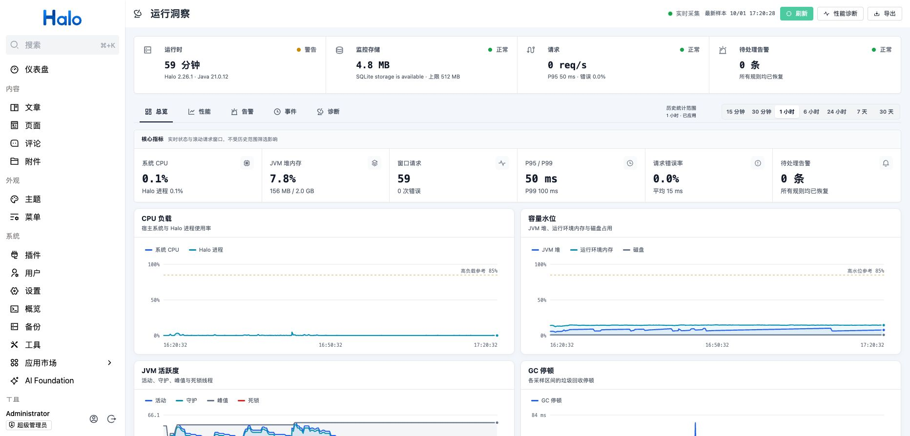
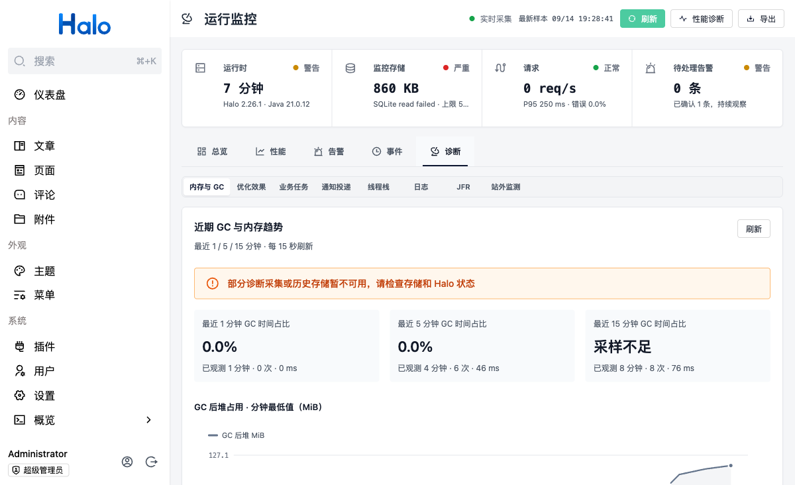
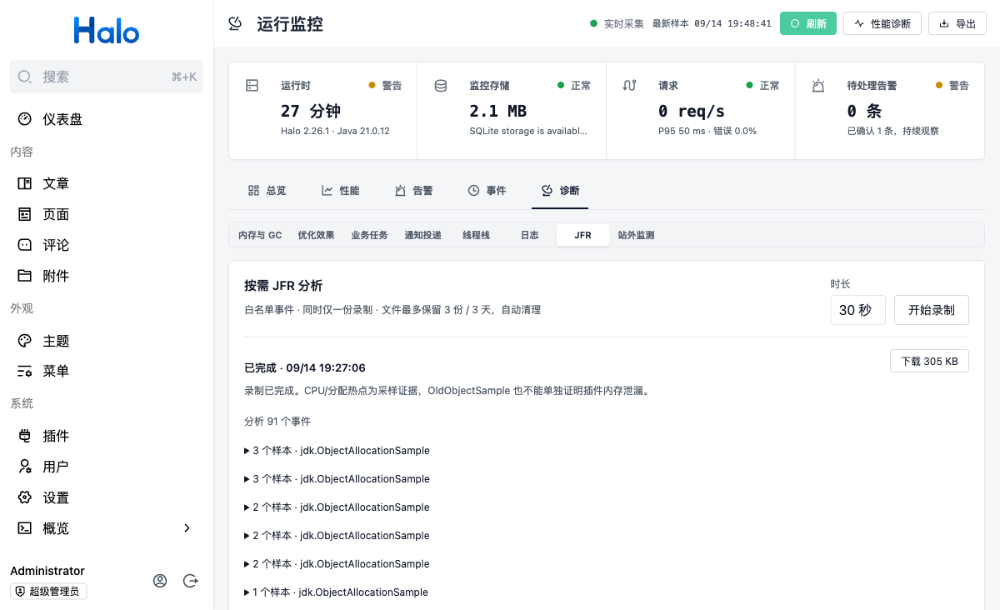

# 运行洞察

Halo 2.26+ 的运行监控、性能诊断与告警洞察插件。

## 简介

运行洞察在 Halo 进程内采集系统、JVM、请求与插件运行信号，并提供 Console
监控页、性能诊断、依赖健康、告警通知与事件时间线。请求监控不采集请求正文、查询参数或 Cookie。
SQLite 保存结构化指标、事件、诊断摘要和通知队列；管理员可按需检索 Halo 已有日志，
日志不重复写入 SQLite。日志、线程栈与 JFR 使用独立的诊断权限。

## 功能

- 运行总览：健康状态、运行时长、Halo/Java 版本、CPU、内存、磁盘和当前告警
- JVM：堆/非堆、GC 次数与停顿、线程和死锁检测
- 请求：请求量、5xx 错误率、平均/P95/P99、状态码分布和慢路由排行
- Halo：插件状态、数据库查询、搜索引擎、附件存储只读健康探测和采集任务状态
- 插件影响排行：展示全部已识别插件最近采样周期的 CPU 百分比、内存分配速率和活动线程，
  并按请求耗时、错误率、请求量及历史区间资源信号估算影响；内存指标不等于驻留堆
- Issue 反馈：对持续高消耗或运行失败插件生成可编辑的证据描述，并跳转到插件声明的
  GitHub/GitLab Issue 创建页；描述默认不包含站点地址、配置、请求正文和原始日志
- 告警：持续时间、恢复、确认、冷却抑制和历史记录
- 通知：Halo 通知（按用户偏好发送站内消息或邮件）与出站 Webhook
- 时间线：运行洞察启停、插件启停/版本变化、配置变更、异常和告警恢复
- 数据：默认 15 秒采样、分钟请求聚合、分域保留、容量保护、清理与 JSON 导出
- 优化效果：停用插件前后各 5 分钟 CPU、堆、GC、P95 对比，持久化报告及重新启用入口
- 内存诊断：GC 后堆趋势、持续增长信号、最近 1/5/15 分钟 GC 压力及按需 JFR 录制
- 增强告警：持续高消耗插件、依赖异常、业务任务异常、GC 压力与堆增长
- 可靠投递：通知持久化、失败重试、投递历史及确认后取消待重试告警
- 业务任务：Halo 备份耗时与失败、宿主公开线程池活动数和待执行队列
- 故障定位：近期日志筛选、异常堆栈聚合、热点线程和死锁线程栈

使用入口与能力边界见 [诊断功能说明](docs/diagnostics.md)。

## 界面预览

### 功能首页



### 内存与 GC 诊断



### JFR 分析



截图展示运行洞察的功能首页、GC 后堆趋势、采样状态和按需 JFR 分析入口。

当前版本：1.0.0。

> Halo 插件共享同一个 JVM，运行洞察只归属采样前后持续使用同一插件上下文类加载器
> 的线程；共享线程池保持“未归属”。CPU 与分配量占比的分母分别是本轮已检查 JVM
> 线程的 CPU 增量和新分配字节；“分配内存”是查询区间内新分配的字节量，不是插件
> 当前保留堆内存。接口同时
> 返回能力可用性、覆盖率和置信度，所有资源结果仍明确标注为估算。

附件存储探测复用已有附件，通过 Halo 的存储处理器解析访问地址，再对 HTTPS
公网地址发送不读取响应体、也不跟随重定向的 HEAD 请求。探测不会上传或删除
文件；没有可用样本，或地址属于 HTTP、私网、回环、链路本地/云元数据网段时，
状态会明确显示为“受限/未知”，并且不会发起网络请求。

## 数据存储

历史数据保存到插件目录的 `insight/insight.sqlite`。存储层使用 WAL、短事务、
逐版本迁移、损坏库隔离恢复和分批 TTL 清理。SQLite 故障或达到容量上限时，
插件会暂停历史写入，但实时采集与内存告警继续运行。

## 开发环境

- Java 21+
- Node.js ^20.19.0 or >=22.12.0
- pnpm

## 开发

```bash
# 启动 Halo 开发服务
bash ./gradlew haloServer
# 开发前端
cd ui
pnpm install
pnpm dev
```

## 构建

```bash
bash ./gradlew build
```

构建完成后，可以在 `build/libs` 目录找到插件 jar 文件。

## 许可证

[GPL-3.0](./LICENSE) © Handsome
